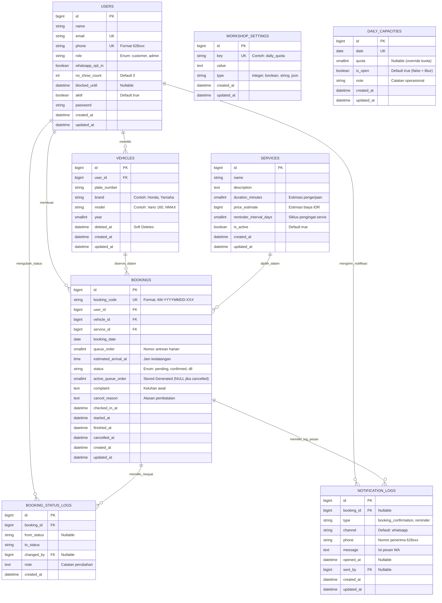

# Entity Relationship Diagram (ERD) — ALDI-MOTOR
**Platform Reservasi dan Manajemen Servis Bengkel UMKM**
*GTNIC 2026 — Web Development Competition*

---

## 1. Diagram ERD (Mermaid)

---

## 2. Penjelasan Pilihan Index dan Constraint Arsitektural

1. **Composite Unique Constraint pada Kendaraan**: Kami menerapkan kombinasi `UNIQUE (user_id, plate_number)` pada tabel `vehicles` guna mencegah duplikasi pencatatan plat nomor oleh pemilik yang sama tanpa mengunci hak registrasi ulang jika kendaraan berpindah kepemilikan ke pengguna lain.
2. **Partial Unique Constraint Antrean via Stored Generated Column**: Kolom *stored generated* `active_queue_order` yang hanya bernilai `queue_order` jika status bukan `cancelled` memungkinkan constraint `UNIQUE (booking_date, active_queue_order)` berjalan secara parsial di MySQL, sehingga slot antrean yang dibatalkan dapat dialokasikan ulang tanpa melanggar integritas unik.
3. **Composite Index Performa Kuota dan Tanggal**: Index komposit pada `(booking_date, status)` diterapkan pada tabel `bookings` untuk mempercepat query agregasi perhitungan kuota harian yang dieksekusi secara intensif setiap kali pengguna memeriksa ketersediaan slot tanpa melakukan *full table scan*.
4. **Integritas Foreign Key Bertingkat**: Relasi *foreign key* dikonfigurasi dengan aturan terukur: penghapusan akun `users` akan memicu `cascade` pada kendaraan miliknya, sedangkan penghapusan master `services` dibatasi (`restrict`) agar seluruh histori transaksi servis terdahulu tidak mengalami kerusakan integritas data (*orphaned records*).
5. **Audit Trail & Logging Terisolasi**: Tabel `booking_status_logs` dan `notification_logs` diindeks pada `booking_id` untuk memastikan penelusuran riwayat status pengerjaan dan log komunikasi WhatsApp berlangsung cepat dalam hitungan milidetik saat dievaluasi oleh mekanik maupun administrator bengkel.
